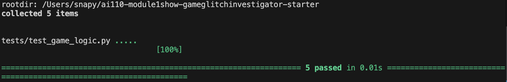

# 🎮 Game Glitch Investigator: The Impossible Guesser

## 🚨 The Situation

You asked an AI to build a simple "Number Guessing Game" using Streamlit.
It wrote the code, ran away, and now the game is unplayable. 

- You can't win.
- The hints lie to you.
- The secret number seems to have commitment issues.

## 🛠️ Setup

1. Install dependencies: `pip install -r requirements.txt`
2. Run the broken app: `python -m streamlit run app.py`

## 🕵️‍♂️ Your Mission

1. **Play the game.** Open the "Developer Debug Info" tab in the app to see the secret number. Try to win.
2. **Find the State Bug.** Why does the secret number change every time you click "Submit"? Ask ChatGPT: *"How do I keep a variable from resetting in Streamlit when I click a button?"*
3. **Fix the Logic.** The hints ("Higher/Lower") are wrong. Fix them.
4. **Refactor & Test.** - Move the logic into `logic_utils.py`.
   - Run `pytest` in your terminal.
   - Keep fixing until all tests pass!

## 📝 Document Your Experience

- [ ] Describe the game's purpose.
This project is a Streamlit-based number guessing game where the player tries to guess a secret number using the feedback provided by the app. The game is meant to give the player helpful hints, track progress across guesses, and allow new rounds to start cleanly.
- [ ] Detail which bugs you found.
While testing the game, I found three main issues. The first bug was that the hint logic was reversed, so the game gave the wrong direction after a guess. The second bug was that the New Game button did not fully reset the game once a round had ended, which prevented new guesses from being accepted. The third issue was that the difficulty labels did not match the actual ranges, making the difficulty progression confusing.
- [ ] Explain what fixes you applied.
To fix these issues, I moved the check_guess logic into logic_utils.py and corrected the hint behavior so the feedback now matches whether the guess is too high or too low. I also updated the New Game reset logic so the game status returns to "playing" when a new round starts, allowing the player to keep using the app normally after a completed game. Finally, I added and updated pytest tests to verify the repaired guess logic and confirmed the fixes through both automated testing and manual testing in the live Streamlit app.

## 📸 Demo

- [ ] 

## 🚀 Stretch Features

- [ ] [If you choose to complete Challenge 4, insert a screenshot of your Enhanced Game UI here]
